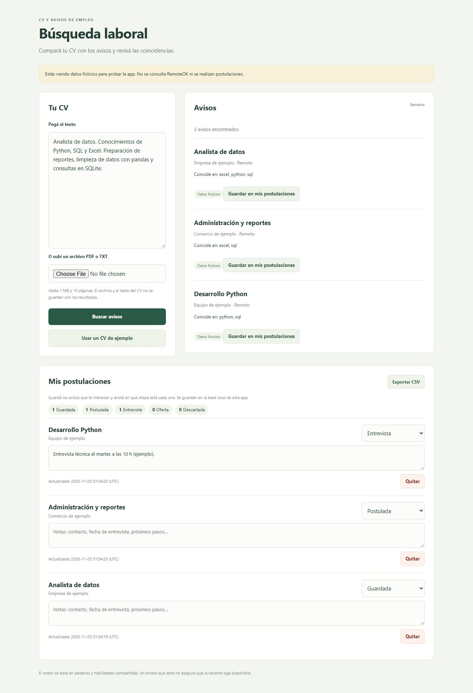
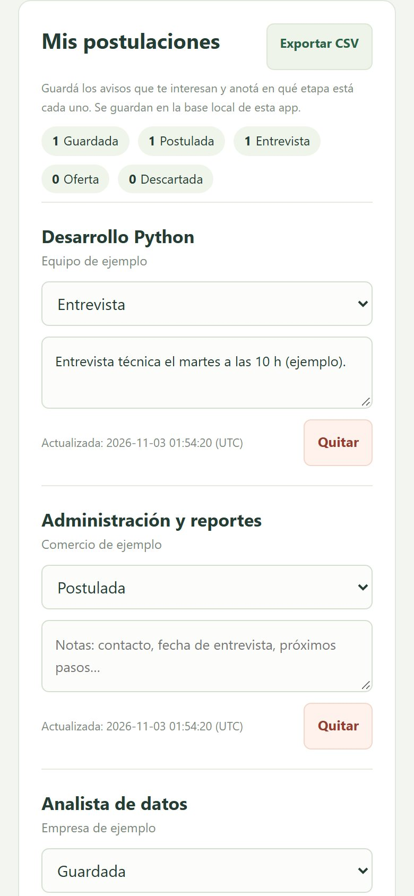

# Búsqueda laboral

[](https://github.com/juliomarianocampuzano-git/busqueda-laboral/actions/workflows/ci.yml)

Compara un CV con avisos de RemoteOK, muestra las habilidades que coinciden y te deja llevar el seguimiento de cada postulación: guardada, postulada, entrevista, oferta o descartada. Podés pegar el texto del CV o subir un PDF/TXT.



<details>
<summary>Vista en celular</summary>



</details>

## Cómo usarla

Requiere Python 3.11 o posterior.

```powershell
python -m venv .venv
.\.venv\Scripts\python.exe -m pip install -r requirements.txt
.\.venv\Scripts\python.exe app.py
```

Abrí http://127.0.0.1:5055. En Linux o macOS usá `.venv/bin/python` en lugar de `.\.venv\Scripts\python.exe`.

## Probar sin consultar ofertas reales

```bash
python app.py --demo
```

Tocá **Usar un CV de ejemplo** y después **Buscar avisos**. La app muestra tres avisos ficticios incluidos en `samples/ofertas.json`. En este modo no hay enlaces de postulación ni llamadas a RemoteOK.

## Seguimiento de postulaciones

Cada aviso tiene el botón **Guardar en mis postulaciones**. Abajo, en **Mis postulaciones**, podés:

- Cambiar el estado: guardada, postulada, entrevista, oferta o descartada.
- Anotar contacto, fechas o próximos pasos. Se guardan al salir del campo.
- Ver cuántas hay en cada estado y quitar las que ya no te interesan.
- Descargar todo en CSV (UTF-8, listo para abrir en una planilla).

Si guardás el mismo aviso dos veces, no se duplica. Las postulaciones se guardan en la misma base local que los resultados; no se envía nada a las empresas.

| Método | Ruta                     | Qué hace                                  |
| ------ | ------------------------ | ----------------------------------------- |
| GET    | /api/postulaciones       | Lista, con la cantidad por estado         |
| POST   | /api/postulaciones       | Guarda un aviso (`position`, `company`, `apply_url`) |
| PATCH  | /api/postulaciones/1     | Cambia `status` o `notes`                 |
| DELETE | /api/postulaciones/1     | Quita una postulación                     |
| GET    | /api/postulaciones.csv   | Descarga el CSV                           |

## Qué hace con el CV

El archivo se lee en memoria. No se guarda una copia del archivo ni el texto del CV en las búsquedas nuevas. Tampoco se envía el CV a RemoteOK: la consulta descarga avisos públicos y la comparación se hace en esta aplicación.

Acepta PDF o TXT de hasta 1 MB. Los PDF pueden tener hasta 10 páginas; no se aceptan archivos con contraseña. Si el PDF es una imagen escaneada, pegá el texto del CV. El texto debe tener entre 40 y 50.000 caracteres.

Los resultados se guardan en SQLite en `data/busqueda.db`: título del aviso, empresa, enlace y coincidencias. Podés elegir otra base con la variable `BUSQUEDA_DATABASE`.

La versión anterior guardaba un fragmento del CV. Para quitar esos fragmentos de una base anterior, configurá la ruta de esa base y ejecutá:

```powershell
$env:BUSQUEDA_DATABASE = "$PWD/data/ofertas.db"
.\.venv\Scripts\python.exe -m flask --app app:create_app borrar-textos-cv
```

Ese comando borra únicamente los fragmentos de CV; conserva los resultados.

## Cómo ordena los avisos

Combina similitud de texto con habilidades que aparecen en ambos lados. Busca palabras completas: “JavaScript” no cuenta como “Java”, ni “Django” como “Go”. El puntaje sirve para ordenar avisos; no representa una probabilidad de contratación.

## Consulta y enlaces

La fuente es [RemoteOK](https://remoteok.com), mediante su [API pública](https://remoteok.com/api).

- Los avisos se guardan en caché durante cinco minutos.
- Se comprueban hasta veinte enlaces, de a cuatro, con un límite de espera de ocho segundos para esa etapa.
- Un enlace puede aparecer como **accesible** o **sin verificar**. Los que responden que ya no existen se descartan.
- Las redirecciones, bloqueos y esperas agotadas se muestran como “sin verificar”.
- Que un enlace abra no garantiza que el puesto siga disponible.

La consulta de avisos también tiene límites de tiempo y tamaño. Si RemoteOK falla, la app muestra un mensaje y permite volver a intentar.

## Pruebas

```bash
python -m pip install -r requirements-dev.txt
python -m pytest -q
python -m ruff check .
python -m ruff format --check .
node --check static/app.js
```

Las pruebas normales no usan Internet ni datos personales. La prueba de consulta real se ejecuta por separado:

```bash
python -m pytest -q -m integration
```

## Alcance

Es una app para uso local. Lleva el registro de tus postulaciones, pero no las envía, no modifica el CV y no tiene cuentas de usuario. Escucha en tu computadora, con el depurador apagado.

## Licencia

MIT. Ver [LICENSE](LICENSE).
